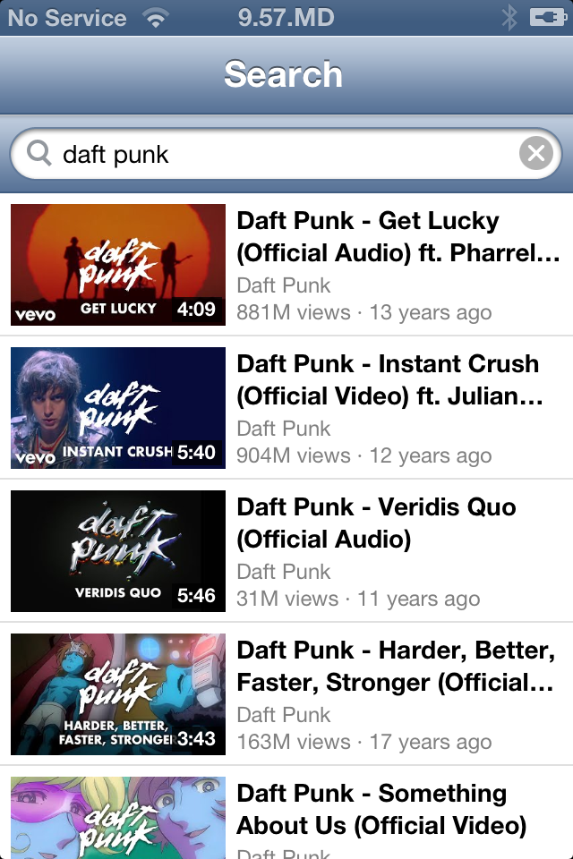
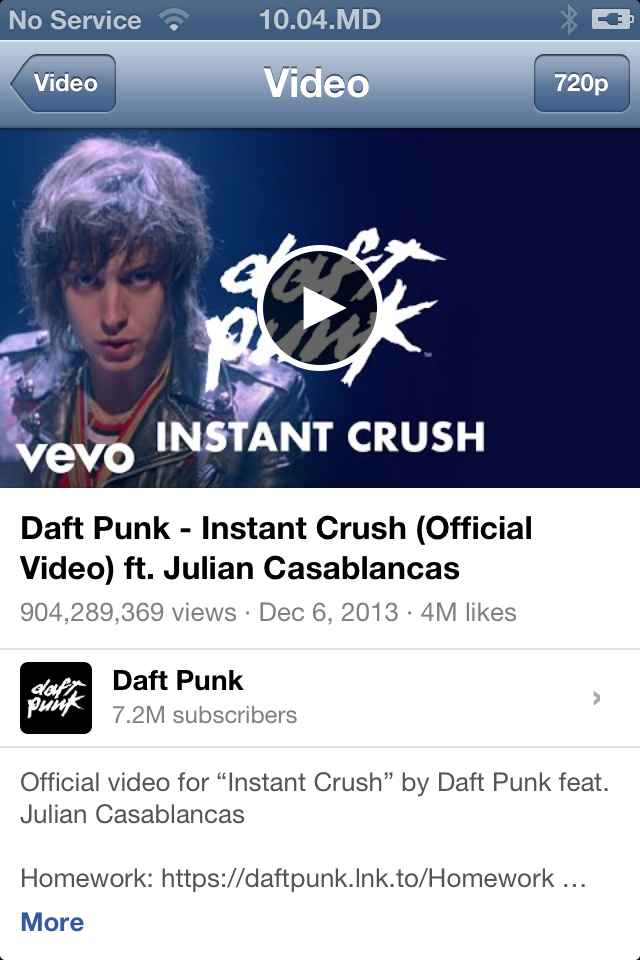

<div align="center">


### A YouTube client for the iPhone 4S on iOS 6

_Native UIKit, no server, no account_


[](LICENSE)
[](https://github.com/Stiven-Gjekaj/RetroTube/releases/latest)

<p align="center">
  <a href="#overview"><b>Overview</b></a> |
  <a href="#install"><b>Install</b></a> |
  <a href="#build"><b>Build</b></a> |
  <a href="docs/architecture.md"><b>Architecture</b></a> |
  <a href="TODO.md"><b>Roadmap</b></a>
</p>

</div>

---

> [!NOTE]
> **Version 0.2.1 is out.** It searches YouTube, shows a page for each video
> with its related videos, shows the videos of a channel, and plays videos up
> to 1080p.
> [TODO.md](TODO.md) lists what comes before 1.0.0.
> [docs/decisions.md](docs/decisions.md) holds each decision and its reason.

---

<table>
<tr>
<td width="33%" valign="top">

<p align="center"><i>Search</i></p>
</td>
<td width="33%" valign="top">

<p align="center"><i>The page of a video</i></p>
</td>
<td width="33%" valign="top">

<p align="center"><i>The movie player of iOS 6</i></p>
</td>
</tr>
</table>

## Overview

**RetroTube** plays YouTube on an iPhone 4S with iOS 6.1.3. The official app
and the website stopped working on iOS 6 many years ago. RetroTube is a new
native app for the old system. It looks like the other apps of iOS 6.

The app speaks to YouTube directly with the TLS of iOS 6. It does not use a
server between the phone and YouTube, and it does not need a Google account.

YouTube sends the video and the sound as two separate streams that iOS 6
cannot play. The app joins them on the phone. A small server in the app, on
`127.0.0.1`, changes the streams into HLS that the movie player of iOS 6 plays,
with seek and the standard controls.
[docs/architecture.md](docs/architecture.md) tells how.

## Features

- Search for videos and channels, with more results as you scroll
- A page for each video: the title, the views, the date, the likes, the
  channel, the description, and the related videos
- The videos of a channel, newest first
- Play videos in H.264 with sound, seek, and full screen
- Choose the highest quality, from 240p to 1080p. The default is 720p.
- Paste a YouTube link into the search bar to open its video or channel
- Open `retrotube://` links from other apps:
  `retrotube://search?q=TEXT`, `retrotube://watch?v=ID`,
  `retrotube://channel?id=UC...`

Before 1.0.0: local subscriptions with a feed, a history, and a Popular tab.

## Install

You need an iPhone, iPod touch, or iPad with iOS 6 and a jailbreak.

1. Download the `.deb` file from the
   [latest release](https://github.com/Stiven-Gjekaj/RetroTube/releases/latest).
2. Copy it to the phone, for example with `scp` to `/tmp/`.
3. On the phone, as root: `dpkg -i /tmp/io.github.stivengjekaj.retrotube_*.deb`.

The RetroTube icon comes on the home screen. To remove the app:
`dpkg -r io.github.stivengjekaj.retrotube`.

## Build

You need a Mac with Xcode and the iOS 9.3 SDK of Theos.

1. Download `iPhoneOS9.3.sdk.tar.xz` from the releases of
   [theos/sdks](https://github.com/theos/sdks/releases) and unpack it into
   `sdks/`. The result is `sdks/iPhoneOS9.3.sdk`. Git does not track `sdks/`.
2. Run `./fix-sdk.sh` one time. It changes the SDK stubs for the new Apple
   linker and for iOS 6.
3. Build:

| Command | Result |
| ------- | ------ |
| `scripts/app.sh` | `build/RetroTube.app` |
| `scripts/deb.sh` | The Cydia package in `build/` |
| `scripts/test.sh` | The tests, on the Mac |
| `scripts/test.sh --phone` | The tests, on the phone |
| `RT_LIVE=1 scripts/test.sh` | Also the tests that use the network |
| `scripts/install.sh` | Builds the app, copies it to the phone, and opens it |

The phone scripts use `ssh iphone4s`. Set up that host in `~/.ssh/config`,
for example with a USB tunnel of `iproxy` on port 2222.

`build.sh` builds one armv7 binary. It compiles with ARC and links without
ARC, and all code is in ARM mode (`-marm`). The new Apple linker makes Thumb
code that crashes on iOS 6 before `main` starts.

To run a tool on the phone:

```
./build.sh build/X probe/X.m -framework Foundation
scp build/X iphone4s:/tmp/
ssh iphone4s 'ldid -S /tmp/X && /tmp/X'
```

`probe/` holds three tools: `main.m` tests the TLS and the player API,
`play.m` plays and seeks a video with no interface, and `shot.m` saves a
screenshot.

## Licence

MIT. See [LICENSE](LICENSE). RetroTube is not made by YouTube or Google, and
they do not support it. See [TERMS.md](TERMS.md).
